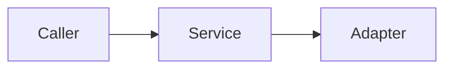

> [!NOTE]
> ### ⚡ 5-Second Quick Glance
>
> * 🔴 **PROBLEM** ➔ **[Core issue in bold]:** Short 1-sentence description of what was broken or triggered.
> * 🟢 **SOLUTION** ➔ **[Key change in bold]:** Short 1-sentence description of what was changed or added.
> * 🛡️ **IMPACT** ➔ **[Risk level in bold]:** Short 1-sentence description of runtime impact and blast radius.
>
> 

> 
🇷🇺 <b>По-русски (нажмите, чтобы развернуть карточку)</b>

>
> * 🔴 **ПРОБЛЕМА** ➔ **[Суть жирным]:** Краткое описание проблемы на русском.
> * 🟢 **РЕШЕНИЕ** ➔ **[Суть жирным]:** Краткое описание решения на русском.
> * 🛡️ **ВЛИЯНИЕ** ➔ **[Уровень риска жирным]:** Оценка рисков на русском.
> 

| Area / Component | Change Summary | Production Risk |
| :--- | :--- | :---: |
| <!-- e.g. frontend/src/components/ChatButton.tsx or backend/internal/service.go --> | <!-- Summary of change --> | 🟢 Low |

---

## Problem and behavior

Describe the concrete trigger, user impact, and resulting behavior in detail.
- Link related issue / task (if any):
- PR stack index (target <= 300 LOC):

🇷🇺 <b>Описание на русском (по желанию)</b>

Подробное описание проблемы, поведения и изменений на русском языке.

## Architecture and Call Trace

Describe the affected layers, flows, or UI components.

<!-- 
  REQUIREMENTS:
  - BACKEND PR: Mandatory Mermaid visual diagram (flowchart LR or sequenceDiagram).
  - FRONTEND PR: Mermaid is optional; describe UI structure or provide diagram if helpful.
-->

## Evidence & TDD Verification

Detail automated verification and visual evidence:
- Tests added or verified (Red-Green TDD cycle):
- Exact commands and results (e.g. npm test, go test, scripts/pre-pr.sh):

<!-- 
  REQUIREMENTS:
  - FRONTEND PR: Mandatory real screenshot images (Before and After) under mock server.
    Embed real markdown images: `` and `` or ``.
  - BACKEND PR: Visual screenshots are N/A; automated test outputs are required.
-->

### Visual Evidence (Frontend)
| Before (defect / prior) | After (fixed / current) |
| :---: | :---: |
| <!-- `` --> | <!-- `` --> |

## Risks and manual review

Explain material risks and provide 1-2-3 reproducible manual verification steps:
1. <!-- Step 1: Open ... -->
2. <!-- Step 2: Perform action ... -->
3. <!-- Step 3: Observe expected result ... -->
