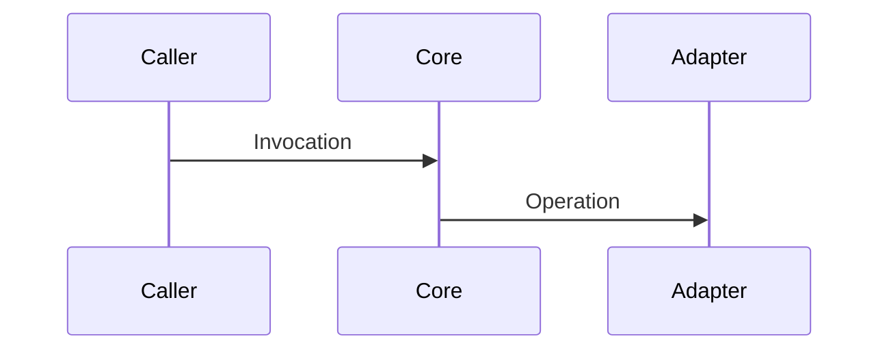

## Problem and behavior

Describe the concrete trigger, user impact, and resulting behavior.
- Link approved SDD contract / specification:
- Related issue (if any):
- PR stack index (target <= 300 LOC, strict <= 400 LOC):

## Architecture and Call Trace

Describe the affected layers, flows, and callers. Include a Mermaid diagram illustrating component interactions when applicable.

## Evidence & TDD Verification

Detail the TDD Red-Green cycle and automated verification:
- Observable tests added before implementation (confirming Red failure):
- Implementation changes making tests pass (Green):
- Exact commands and results:
- Acceptance coverage & independent QA:
- Visual evidence (before/after screenshot links reproduced on mock server): Not applicable / Attached below.

## Risks and manual review

Explain material risks, security considerations (tenant isolation, replay protection), and a short reproducible manual review scenario.
