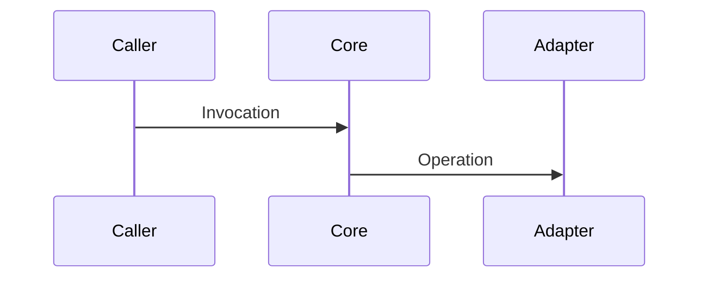

> [!NOTE]
> ### ⚡ 5-Second Quick Glance
>
> * 🔴 **PROBLEM** ➔ **[Core issue in bold]:** Short 1-sentence description of what was broken or triggered.
> * 🟢 **SOLUTION** ➔ **[Key change in bold]:** Short 1-sentence description of what was changed or added.
> * 🛡️ **IMPACT** ➔ **[Risk level in bold]:** Short 1-sentence description of runtime impact and blast radius.
>
> 

> 
🇷🇺 <b>По-русски (нажмите, чтобы развернуть карточку)</b>

>
> * 🔴 **ПРОБЛЕМА** ➔ **[Суть жирным]:** Краткое описание проблемы на русском.
> * 🟢 **РЕШЕНИЕ** ➔ **[Суть жирным]:** Краткое описание решения на русском.
> * 🛡️ **ВЛИЯНИЕ** ➔ **[Уровень риска жирным]:** Оценка рисков на русском.
> 

| Area / Component | Change Summary | Production Risk |
| :--- | :--- | :---: |
| <!-- e.g. backend/Dockerfile --> | <!-- e.g. Upgrade Go builder to 1.26-alpine --> | 🟢 Low (Build-only) |

---

## Problem and behavior

Describe the concrete trigger, user impact, and resulting behavior in detail.
- Link approved SDD contract / specification:
- Related issue (if any):
- PR stack index (target <= 300 LOC, strict <= 400 LOC):

🇷🇺 <b>Описание на русском (по желанию)</b>

Подробное описание проблемы, поведения и изменений на русском языке.

## Architecture and Call Trace

Describe the affected layers, flows, and callers.

**Mandatory visual diagram (choose one):**
- **Horizontal Flowchart (`flowchart LR`)**: Default for bug fixes, configs, Docker, migrations, pipelines. Flowcharts must be horizontal (`LR`) to optimize vertical screen real estate. Always use `-->|label|` for arrow text (never `-- "text" -->`), and ` ` for multiline text inside `["labels"]`.
- **Sequence diagram (`sequenceDiagram`)**: For multi-component features, API requests, state machines.

## Evidence & TDD Verification

Detail the TDD Red-Green cycle and automated verification:
- Observable tests added before implementation (confirming Red failure):
- Implementation changes making tests pass (Green):
- Exact commands and results:
- Acceptance coverage & independent QA:
- Visual evidence (before/after screenshot links reproduced on mock server): Not applicable / Attached below.

## Risks and manual review

Explain material risks, security considerations (tenant isolation, replay protection), and a short reproducible manual review scenario:
1. <!-- Step 1: Open ... -->
2. <!-- Step 2: Perform action ... -->
3. <!-- Step 3: Observe expected result ... -->
