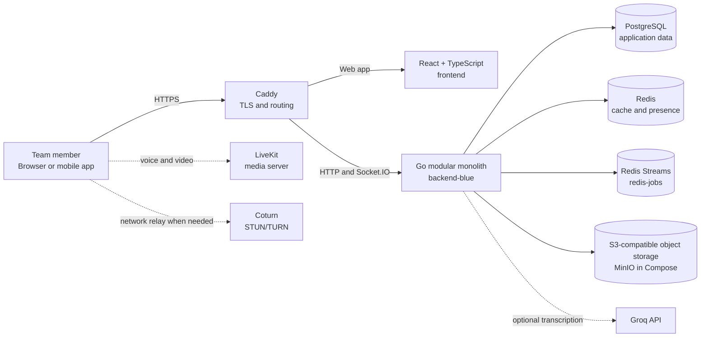

<div align="center">
  
</div>

<h1 align="center">Stovo</h1>

<p align="center"><strong>Self-hosted corporate messenger</strong></p>

> Your company's private workspace. On your terms.

<p align="center">
  Messaging, meetings, files, and team coordination — on infrastructure you control.
</p>

<p align="center">
  <a href="https://stovo.ru"></a>
  
  
  
  <a href="https://github.com/stovo-team/stovo-messenger/actions/workflows/docs-validation.yml"></a>
</p>

<p align="center">
  <a href="#get-started">Get started</a> ·
  <a href="#what-teams-can-do">Explore features</a> ·
  <a href="docs/README.md">Read the docs</a> ·
  <a href="https://stovo.ru">Visit stovo.ru</a>
</p>

## Product at a glance

Stovo is a **self-hosted corporate messenger and shared workspace** for teams that want everyday communication and coordination in one place, while choosing where the application and its data run.

Use it for the conversations that keep work moving, the calls that unblock decisions, and the plans and files that teams need to find again later. Deploy one Stovo instance for your organization and manage its application, database, storage, and backups on infrastructure you operate.

| 💬 Communicate | 🗂️ Coordinate | 🎙️ Meet |
| --- | --- | --- |
| Direct and group chats, message search, replies, reactions, attachments, scheduled messages, and reminders. | Shared plans, checklists, polls, and collaborative Canvas documents alongside conversations. | Voice and video calls, guest meeting links, call history, live captions, and optional AI call transcription. |

> Stovo can also work for families and other trusted groups, but its primary positioning is a corporate team workspace.

## What teams can do

### Keep conversations useful

- Organize direct and group conversations around the people and projects that need them.
- Find previous messages, reply in context, react, and share files without losing the conversation thread.
- Schedule messages and reminders so follow-ups arrive when they are useful.
- Use real-time updates to keep the web client in sync with chat activity.

### Move from chat to shared work

- Put plans, checklists, and polls in the context of team conversations.
- Create collaborative Canvas documents for information the team needs to maintain together.
- Share files and revisit shared content from the relevant chat.

### Meet without switching tools

- Start voice or video calls from conversations, including group calls.
- Invite guests with meeting links where enabled by the instance administrator.
- Use LiveKit and Coturn for media and network relay when configured by the operator.
- Enable call transcription features with an external provider when configured; AI transcription is optional.

## Designed for your infrastructure

Stovo is self-hosted: your team can run the application in an environment your organization manages. That gives operators control over deployment choices, service credentials, network exposure, storage, and backup procedures.

- **Your deployment:** run the bundled Docker Compose stack or use the repository's Helm chart with external services.
- **Your data services:** the application uses PostgreSQL, Redis, and S3-compatible object storage; you choose bundled or external services where supported by the deployment.
- **Your secrets:** keep database credentials, tokens, and the message-encryption key in protected environment or secret-manager configuration.
- **Your operations:** configure DNS, TLS, user access, retention, monitoring, and backups for your environment.

Message encryption behavior depends on the configured protocol. Self-hosting does not by itself mean end-to-end encryption. Protect `MESSAGE_ENCRYPTION_KEY` as critical data: it must be a Base64 encoding of exactly 32 random bytes, and losing it can make encrypted message data unreadable. See the [security policy](SECURITY.md) and the deployment guides before production use.

## Architecture

The backend is one Go modular monolith. The web client is a React and TypeScript application served through Caddy. Supporting services are separated by role: PostgreSQL stores relational state, Redis handles cache/presence and worker streams, and S3-compatible storage holds uploaded objects. LiveKit and Coturn support calls; Groq can be configured for optional transcription.



The chart and Compose stack do not make every supporting service mandatory for every deployment. For example, the Kubernetes chart expects database, Redis, object storage, and optional media services to be operated separately. See [the architecture map](docs/architecture/subsystems.md) for code ownership and [deployment guides](docs/README.md) for the exact service contracts.

## Get started

The quickest documented path is the production Docker Compose deployment on a Linux host. It builds the backend and frontend locally and starts the application with PostgreSQL, Redis Streams, MinIO, Caddy, and supporting services. A public domain is needed for Caddy to provision HTTPS.

### What you need

- Docker Engine and Docker Compose plugin **2.24.4 or newer**.
- A domain with DNS pointing to the host; TCP ports 80 and 443 available for the web entry point.
- For public calls through TURN, UDP 3478 and UDP 49160–49200 available and a correct public IP/hostname configuration.
- Disk space and backups for the database, uploaded objects, and encryption key.

### Prepare configuration

From the repository root, copy the sample environment file:

```sh
cp .env.example .env
```

Edit `.env` before starting. Set your public hostname and matching application URLs, replace example credentials, and configure `PUBLIC_IP` and `TURN_HOST` when enabling public calls. Generate a fresh 32-byte message-encryption key encoded as Base64:

```sh
openssl rand -base64 32
```

Copy the generated value into `MESSAGE_ENCRYPTION_KEY` in `.env`. Never commit `.env` or paste real credentials into issues, chat, or logs. For calls from remote browsers, set `LIVEKIT_URL` to a `wss://` endpoint reachable by those clients; the sample `ws://localhost:7880` only works for a local client and will fail for users connecting from another device. Use a TLS-enabled endpoint or reverse proxy in production, and follow the [Compose guide](docs/self-hosting/docker-compose.md) for media ports and network configuration.

### Start Stovo

```sh
docker compose --profile disabled --env-file .env config --quiet
docker compose --profile disabled --env-file .env up -d --build
docker compose ps
```

Open `https://<APP_DOMAIN>` and complete the initial owner setup. Registration becomes invite-based after the first owner is created.

The `disabled` profile is enabled here to start the bundled cache/presence Redis service. The durable worker stream service is separate (`redis-jobs`). If you use an external cache Redis, set `REDIS_URL` accordingly. Caddy publishes the web ports; backend, frontend, database, and Redis service ports are internal to the Compose network.

For external PostgreSQL or object storage, service ports, upgrades, backup/restore, and troubleshooting, use the full [Docker Compose guide](docs/self-hosting/docker-compose.md).

## Choose your deployment

| Option | Best for | What it provides | Guide |
| --- | --- | --- | --- |
| **Docker Compose** | A single host and the fastest self-hosted start. | Builds the app and can run PostgreSQL, Redis Streams, MinIO, Caddy, LiveKit, Coturn, and supporting services together. | [Compose deployment](docs/self-hosting/docker-compose.md) |
| **Kubernetes + Helm** | Teams operating an existing cluster. | Backend and frontend workloads, Services, migration Job, optional Ingress, and uploads PVC. Database, Redis, object storage, notifications, and media services are external. | [Kubernetes deployment](docs/self-hosting/kubernetes.md) |

The chart requires you to build or obtain backend and frontend images and push them to a registry accessible by your cluster. It does not package PostgreSQL, Redis, MinIO/S3, LiveKit, or Coturn. The Compose and Helm guides explain the dependencies, configuration, data persistence, and upgrade model for each path.

## Development

Stovo is developed as a Go backend and a React/TypeScript web client. The production backend is one application, not a collection of separately deployed feature services.

#### Fast frontend preview with synthetic chat data

To inspect the real chats page without starting the backend or Docker services, install the frontend dependencies once and start the mock mode:

```sh
cd frontend
npm ci # only needed once, or after package-lock.json changes
npm run dev:mock
```

Open [http://127.0.0.1:5174/app/chats](http://127.0.0.1:5174/app/chats). This serves the actual app, routes, and styles with a synthetic Stovo Demo account and sample direct, group, and channel chats. Messages sent in the preview stay local to the current page session; reload the page to restore the fixture data. Mock mode uses its own loopback origin and does not require backend services.

```sh
# Start the local development stack
docker compose -f docker-compose.dev.yml up -d --build

# Backend tests
cd backend
go test ./...

# Frontend checks
cd ../frontend
npm ci
npm test
npm run lint
npm run build
```

Some backend integration tests need disposable PostgreSQL and Redis services. E2E tests need a running test instance. See [CONTRIBUTING.md](CONTRIBUTING.md) for integration-test environment variables, E2E setup, deployment validation, and pull-request expectations.

## Project status

Stovo is under active development. Features, configuration, and deployment contracts can change between revisions; review the guides and release notes for the version you deploy. Resource values in the Helm chart are starting estimates, not benchmark-backed capacity guarantees.

Stovo is licensed under the [Apache License 2.0](LICENSE).

## Documentation

| Guide | What it covers |
| --- | --- |
| [Documentation index](docs/README.md) | Entry point to the maintained documentation. |
| [License](LICENSE) | Apache License 2.0. |
| [Docker Compose self-hosting](docs/self-hosting/docker-compose.md) | Installation, external services, network exposure, backups, upgrades, and troubleshooting. |
| [Kubernetes and Helm](docs/self-hosting/kubernetes.md) | Chart values, Secret references, storage, ingress, media networking, resource estimates, and upgrades. |
| [Subsystem map](docs/architecture/subsystems.md) | Backend package boundaries, frontend areas, transports, and infrastructure. |
| [Contributing](CONTRIBUTING.md) | Development workflow and pull-request guidance. |
| [Security policy](SECURITY.md) | Private vulnerability reporting and deployment security practices. |
| [Issue templates](.github/ISSUE_TEMPLATE/) | Structured bug reports and feature requests. |

---

<p align="center">
  <strong>Bring your team. Choose your infrastructure. Make the workspace yours.</strong><br>
  <a href="https://stovo.ru">stovo.ru</a> · <a href="docs/README.md">Documentation</a> · <a href="CONTRIBUTING.md">Contribute</a>
</p>
