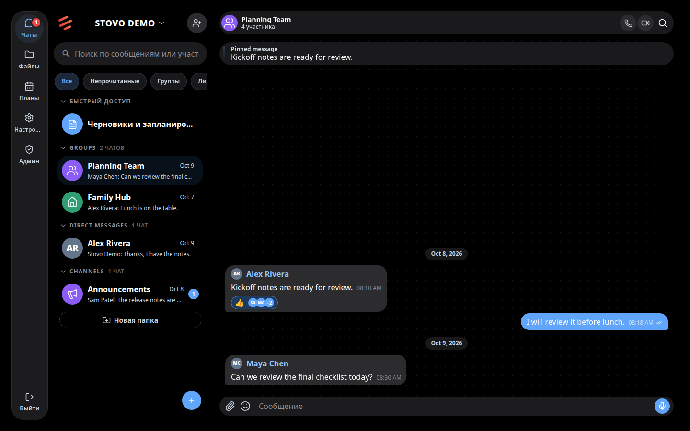
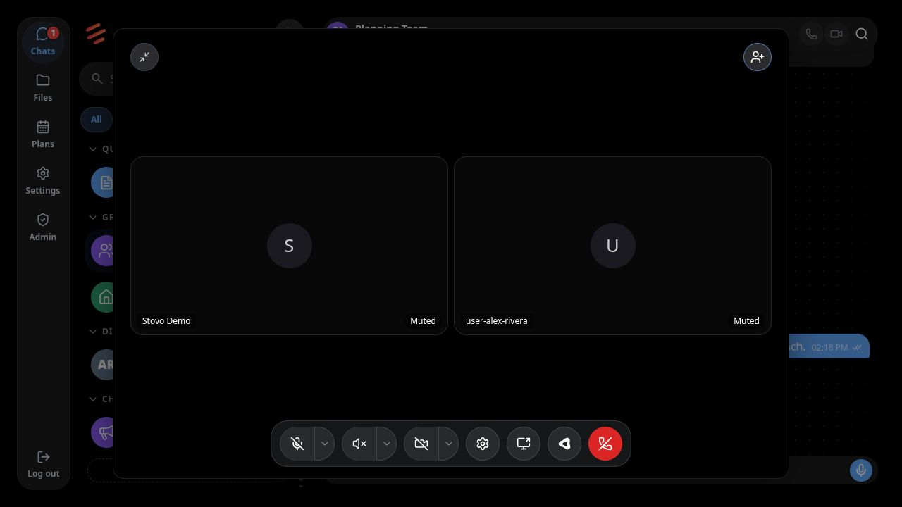

  
  <h1>Stovo</h1>
  
<strong>Self-hosted corporate messenger</strong>

  
Conversations, calls, and shared work — together, on your infrastructure.

  
<a href="https://stovo.ru">Explore Stovo</a> &nbsp;·&nbsp; <a href="docs/self-hosting/docker-compose.md">Self-host Stovo</a> &nbsp;·&nbsp; <a href="docs/README.md">Documentation</a>

  

    
    
  

> Your company's private workspace. On your terms.

## One workspace for team communication

One private workspace for team chat, calls, files, and shared work. Stovo brings the conversations and information your organization relies on together, with the option to run it on infrastructure you manage.

Stovo workspace shown with synthetic demo conversations.

### Conversations that keep context

Bring the right people into a conversation, then keep the details easy to find. Direct and group chats bring together search, replies, reactions, attachments, scheduled messages, and reminders.

### From discussion to action

Turn a conversation into a plan. Share files, gather decisions with polls, track work with checklists, and build shared Canvas documents together. Files shared in conversations can be found again in Storage.

### Meet when a message isn't enough

Go from a conversation to a voice or video call, share your screen, and invite guests with a meeting link. Call history keeps past meetings visible; live captions and optional transcription are available when configured.

Group call interface shown with synthetic demo participants.

**[Explore Stovo on stovo.ru →](https://stovo.ru)**

## Explore Stovo

**Ready to get started?** Choose a [Docker Compose](docs/self-hosting/docker-compose.md) or [Kubernetes and Helm](docs/self-hosting/kubernetes.md) deployment. For configuration, operations, and architecture, visit the [documentation](docs/README.md).

[Website](https://stovo.ru) · [Architecture](docs/architecture/subsystems.md) · [Contributing](CONTRIBUTING.md) · [Security](SECURITY.md) · [License](LICENSE)

## About this project

Stovo is under active development and licensed under the [Apache License 2.0](LICENSE). Features and deployment details can change between revisions. Self-hosting gives operators control over their deployment; it does not by itself mean messages are end-to-end encrypted. Review the [security policy](SECURITY.md) and the documentation for the version you run.
