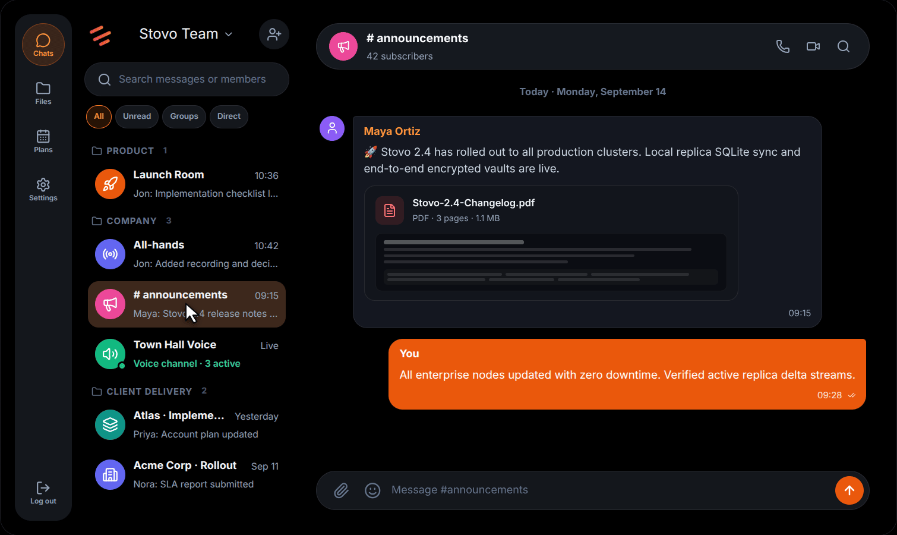
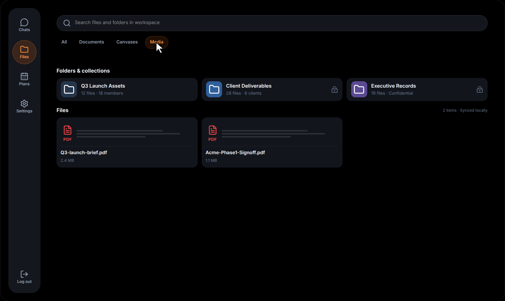
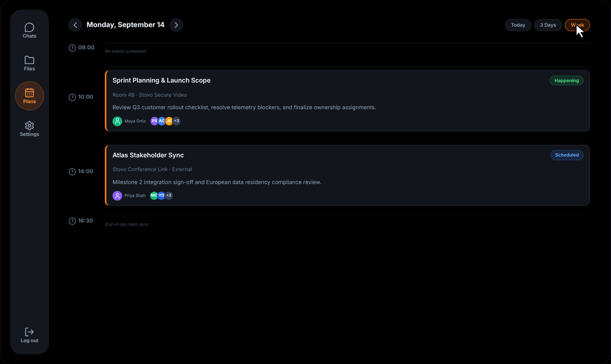
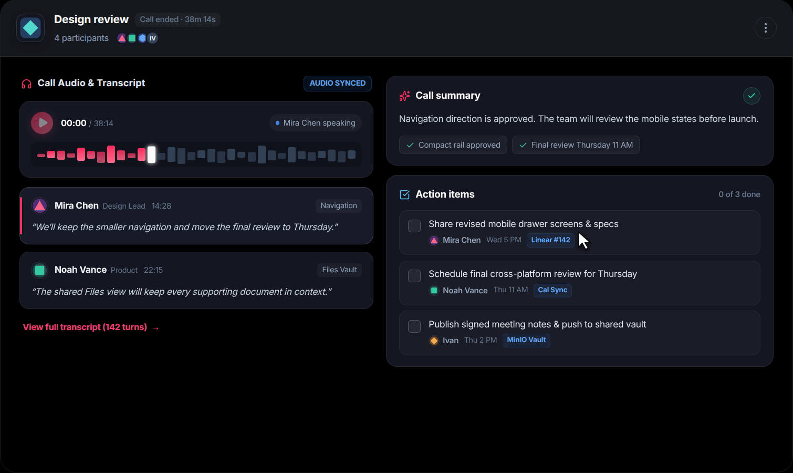

<div align="center">
  
  <h1>Stovo</h1>
  <p><strong>Self-hosted corporate messenger</strong></p>
  <p>Conversations, calls, files and plans — one workspace, on your terms.</p>
  <p>
    <a href="https://stovo.cc"></a>
    <a href="docs/self-hosting/docker-compose.md"></a>
    <a href="LICENSE"></a>
  </p>
  <p><a href="https://stovo.cc">Website</a> &nbsp;·&nbsp; <a href="docs/README.md">Documentation</a> &nbsp;·&nbsp; <a href="#build-from-source">Build from source</a> &nbsp;·&nbsp; <a href="CONTRIBUTING.md">Contributing</a></p>
</div>

> Your company's private workspace. On your terms.

## One workspace for team communication

Bring the people, conversations and information your organization relies on together. Stovo combines messaging, calls, files and shared work in a workspace you can run on infrastructure you manage.

The previews below are recorded from the interactive [Stovo landing page](https://stovo.cc). They use **fictional data and illustrative interface mockups**; their example messages, integrations and status labels are not statements about deployed features or performance.

### Keep the conversation moving

Bring the right people together in direct and group chats. Search messages, reply in context, react, share attachments, and schedule messages or reminders for later.



### Keep every file in reach

Files shared in conversations can be found again in Storage alongside direct uploads. Use checklists, polls and shared Canvas documents to keep work close to the conversation.



### Turn updates into a plan

Coordinate with shared plans and attendees, then move into voice or video calls when a message isn't enough. Calls support screen sharing and guest meeting links when configured.



### Revisit the conversation

Call history helps teams revisit past calls. Transcription and related features depend on instance configuration and an external provider. The following landing-page mockup illustrates a possible notes experience; it is not a feature-by-feature representation of the current interface.



<div align="center"><a href="https://stovo.cc"><strong>Explore the interactive previews at stovo.cc →</strong></a></div>

## Explore Stovo

Choose a [Docker Compose deployment](docs/self-hosting/docker-compose.md) for a single host or [Kubernetes and Helm](docs/self-hosting/kubernetes.md) for an existing cluster. Both guides cover prerequisites, configuration, persistence and operations.

| Looking for | Start here |
| --- | --- |
| Deployment, configuration and operations | [Documentation index](docs/README.md) · [Docker Compose](docs/self-hosting/docker-compose.md) · [Kubernetes](docs/self-hosting/kubernetes.md) |
| Code structure and services | [Architecture map](docs/architecture/subsystems.md) |
| Development and tests | [Contributing](CONTRIBUTING.md) · [End-to-end tests](e2e/README.md) |
| Reporting a problem or suggesting an idea | [GitHub issues](https://github.com/stovo-team/stovo/issues) · [Issue templates](.github/ISSUE_TEMPLATE/) |
| Reporting a vulnerability | [Security policy](SECURITY.md) |

## Build from source

The application consists of a Go backend and a React/TypeScript web client. The repository's build images use Go 1.25.5 and Node.js 22. From the repository root, build each component with:

```sh
# Backend
cd backend
go build -o stovo-server ./cmd/server

# Web client
cd ../frontend
npm ci
npm run build
```

These commands build the components; use the [Compose guide](docs/self-hosting/docker-compose.md) for a configured running instance and [CONTRIBUTING.md](CONTRIBUTING.md) for development, tests and pull requests. Compose builds the application images from the checked-out source.

## About this project

Stovo is under active development and licensed under the [Apache License 2.0](LICENSE). Features and deployment details can change between revisions. Self-hosting gives operators control over their deployment; it does not by itself mean messages are end-to-end encrypted. Review the [security policy](SECURITY.md) and documentation for the version you run.
